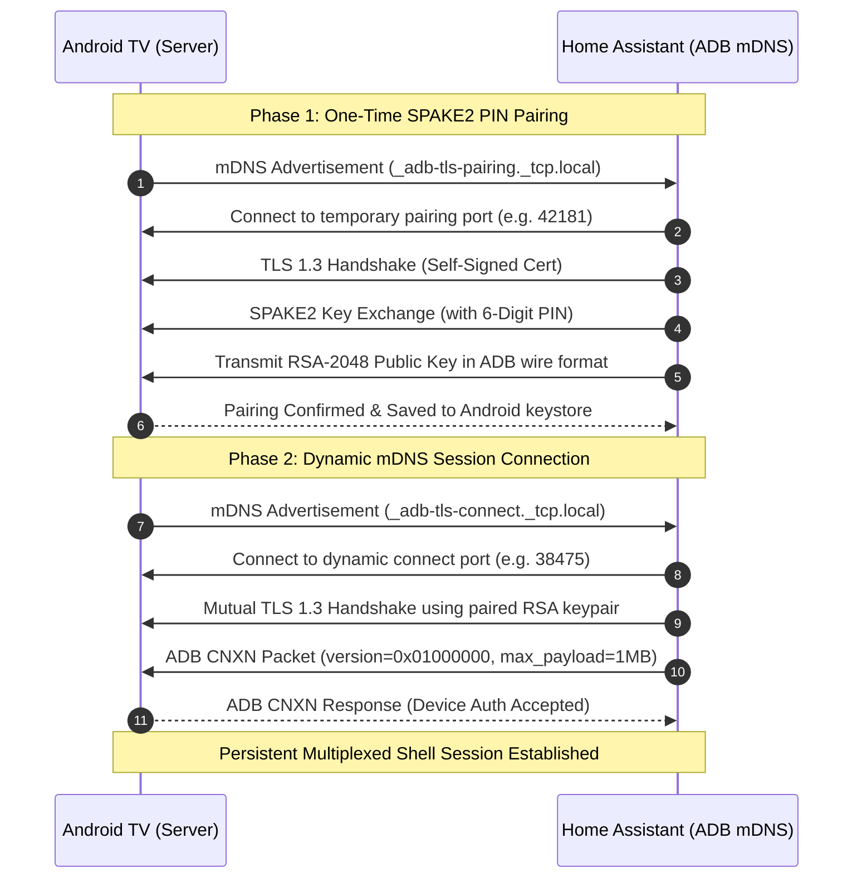

# 🔬 Protocol & Cryptographic Architecture

The **ADB mDNS** integration is built from the ground up to communicate with modern Android 11+ devices using stock Wireless Debugging over **TLS 1.3** and **Zeroconf (mDNS)** discovery.

---

## 🏛️ The Three Core Architectural Invariants

### 1. Zero Port 5555 Invariant
- **No Legacy Ports:** Plaintext TCP port `5555` is never probed, connected to, or expected.
- **Dynamic Port Tracking:** Android 11+ randomizes wireless debugging ports across reboots. The integration listens for Zeroconf mDNS announcements (`_adb-tls-connect._tcp.local.`) and automatically binds to the updated port with zero user intervention.

### 2. Zero Hardcoding Invariant
- **100% Dynamic Telemetry:** Model, manufacturer, software build, serial number, and Wi-Fi/Ethernet MAC addresses are queried dynamically from Android properties (`getprop ro.product.model`, `settings get global device_name`, etc.).

### 3. Pure ADB Shell Execution (Zero On-Device Binaries)
- **No Companion APKs:** Does not install or push any APKs, DEX files, or JAR files to your TV.
- **No Background Servers:** Does not run `scrcpy-server` or third-party daemon processes on the device.
- All state queries and actions utilize stock Android utilities (`dumpsys`, `am`, `pm`, `cmd media_session`, `settings`, `input`).

---

## 🔐 Cryptography & Pairing Lifecycle

---

## 📦 Packet Framing & Wire Format

Communication after TLS 1.3 connection establishment follows the standard ADB framing:

1. **Header (24 bytes):**
   - `command` (4 bytes, little-endian, e.g., `CNXN`, `OPEN`, `OKAY`, `CLSE`, `WRTE`)
   - `arg0` (4 bytes, remote stream ID or protocol version)
   - `arg1` (4 bytes, local stream ID or max payload)
   - `data_length` (4 bytes, payload length)
   - `data_crc32` (4 bytes, CRC32 checksum of payload)
   - `magic` (4 bytes, command XOR `0xFFFFFFFF`)
2. **Payload:**
   - Raw UTF-8 shell strings (`exec:cmd media_session ...` or `shell:dumpsys power ...`).
